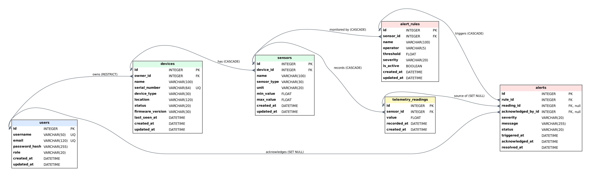
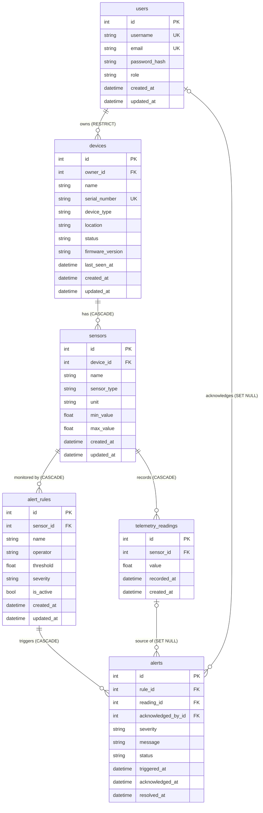

# ERD - IoT Monitor API

Gambar: [`erd.png`](erd.png) (sumber Graphviz: [`erd.dot`](erd.dot), vektor: [`erd.svg`](erd.svg)).

## Diagram (Mermaid, tampil otomatis di GitHub)

## Relasi

| Relasi | Kardinalitas | Foreign key | Aksi saat induk dihapus |
| --- | --- | --- | --- |
| users - devices | 1 : N | `devices.owner_id` -> `users.id` | RESTRICT (user yang masih punya perangkat tidak bisa dihapus; API membalas 409) |
| devices - sensors | 1 : N | `sensors.device_id` -> `devices.id` | CASCADE |
| sensors - telemetry_readings | 1 : N | `telemetry_readings.sensor_id` -> `sensors.id` | CASCADE |
| sensors - alert_rules | 1 : N | `alert_rules.sensor_id` -> `sensors.id` | CASCADE |
| alert_rules - alerts | 1 : N | `alerts.rule_id` -> `alert_rules.id` | CASCADE |
| telemetry_readings - alerts | 1 : 0..N | `alerts.reading_id` -> `telemetry_readings.id` (nullable) | SET NULL (alert tetap sebagai catatan) |
| users - alerts | 1 : 0..N | `alerts.acknowledged_by_id` -> `users.id` (nullable) | SET NULL |

## Atribut per tabel

Semua tabel memakai `id` (integer, auto increment) sebagai **primary key**.

### users
| Kolom | Tipe | Constraint | Keterangan |
| --- | --- | --- | --- |
| id | integer | PK | |
| username | varchar(50) | UNIQUE, NOT NULL | disimpan huruf kecil |
| email | varchar(120) | UNIQUE, NOT NULL | disimpan huruf kecil |
| password_hash | varchar(255) | NOT NULL | hash Werkzeug; tidak pernah dikirim di response |
| role | varchar(20) | NOT NULL, CHECK `admin/operator/viewer` | default `operator` |
| created_at, updated_at | datetime | NOT NULL | UTC |

### devices
| Kolom | Tipe | Constraint | Keterangan |
| --- | --- | --- | --- |
| id | integer | PK | |
| owner_id | integer | FK -> users.id, NOT NULL, INDEX | |
| name | varchar(100) | NOT NULL | |
| serial_number | varchar(64) | UNIQUE, NOT NULL | identitas fisik perangkat |
| device_type | varchar(30) | NOT NULL, CHECK `esp32/esp8266/raspberry_pi/gateway/other` | |
| location | varchar(120) | NULL | |
| status | varchar(20) | NOT NULL, CHECK `active/inactive/maintenance` | hanya `active` yang boleh kirim telemetri |
| firmware_version | varchar(30) | NULL | |
| last_seen_at | datetime | NULL | diperbarui otomatis saat telemetri diterima |
| created_at, updated_at | datetime | NOT NULL | |

### sensors
| Kolom | Tipe | Constraint | Keterangan |
| --- | --- | --- | --- |
| id | integer | PK | |
| device_id | integer | FK -> devices.id, NOT NULL, INDEX | |
| name | varchar(100) | NOT NULL, UNIQUE(device_id, name) | nama unik per perangkat |
| sensor_type | varchar(30) | NOT NULL, CHECK (temperature, humidity, pressure, light, gas, motion, voltage, other) | |
| unit | varchar(20) | NOT NULL | mis. `°C`, `%`, `ppm` |
| min_value, max_value | float | NULL, CHECK `min_value < max_value` | rentang fisik; pembacaan di luar rentang ditolak |
| created_at, updated_at | datetime | NOT NULL | |

### telemetry_readings
| Kolom | Tipe | Constraint | Keterangan |
| --- | --- | --- | --- |
| id | integer | PK | |
| sensor_id | integer | FK -> sensors.id, NOT NULL | indeks gabungan `(sensor_id, recorded_at)` untuk query time-series |
| value | float | NOT NULL | |
| recorded_at | datetime | NOT NULL | waktu pengukuran (UTC) |
| created_at | datetime | NOT NULL | waktu server menerima data |

### alert_rules
| Kolom | Tipe | Constraint | Keterangan |
| --- | --- | --- | --- |
| id | integer | PK | |
| sensor_id | integer | FK -> sensors.id, NOT NULL, INDEX | |
| name | varchar(100) | NOT NULL | |
| operator | varchar(5) | NOT NULL, CHECK `gt/gte/lt/lte` | |
| threshold | float | NOT NULL | |
| severity | varchar(20) | NOT NULL, CHECK `low/medium/high/critical` | default `medium` |
| is_active | boolean | NOT NULL | default true |
| created_at, updated_at | datetime | NOT NULL | |

### alerts
| Kolom | Tipe | Constraint | Keterangan |
| --- | --- | --- | --- |
| id | integer | PK | |
| rule_id | integer | FK -> alert_rules.id, NOT NULL, INDEX | |
| reading_id | integer | FK -> telemetry_readings.id, NULL | pembacaan pemicu |
| acknowledged_by_id | integer | FK -> users.id, NULL | |
| severity | varchar(20) | NOT NULL, CHECK | disalin dari aturan saat alert dibuat |
| message | varchar(255) | NOT NULL | |
| status | varchar(20) | NOT NULL, CHECK `open/acknowledged/resolved` | |
| triggered_at | datetime | NOT NULL | indeks `(status, triggered_at)` |
| acknowledged_at, resolved_at | datetime | NULL | |
